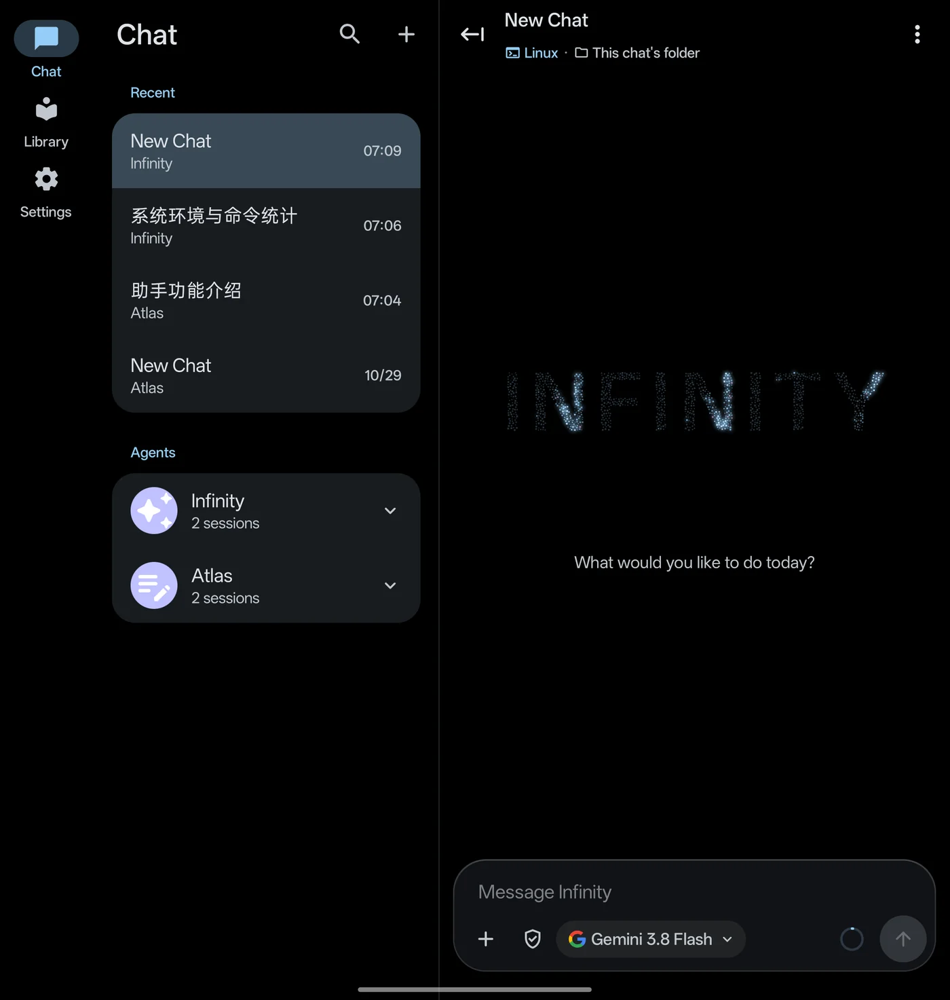
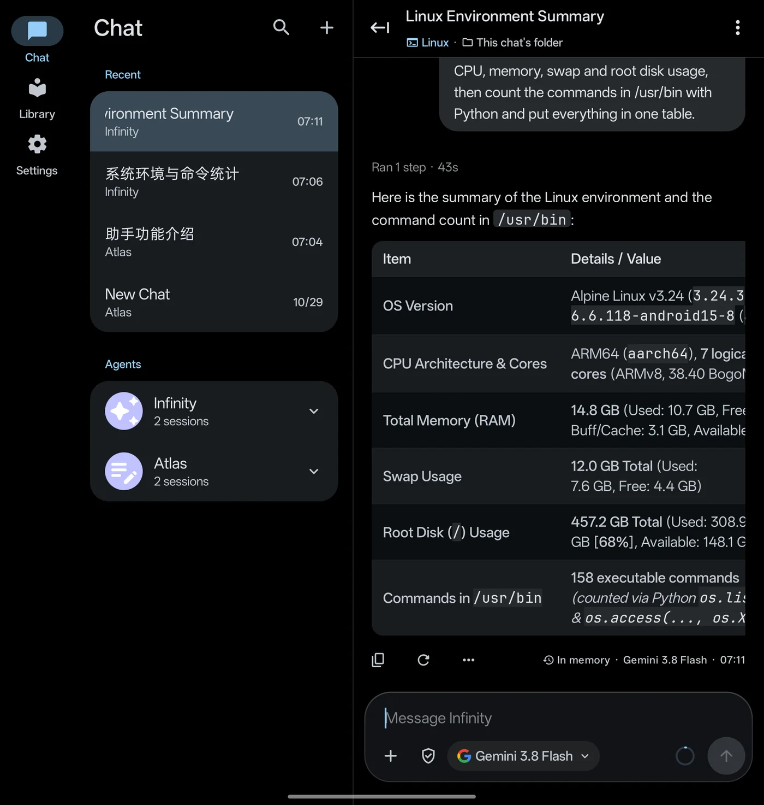
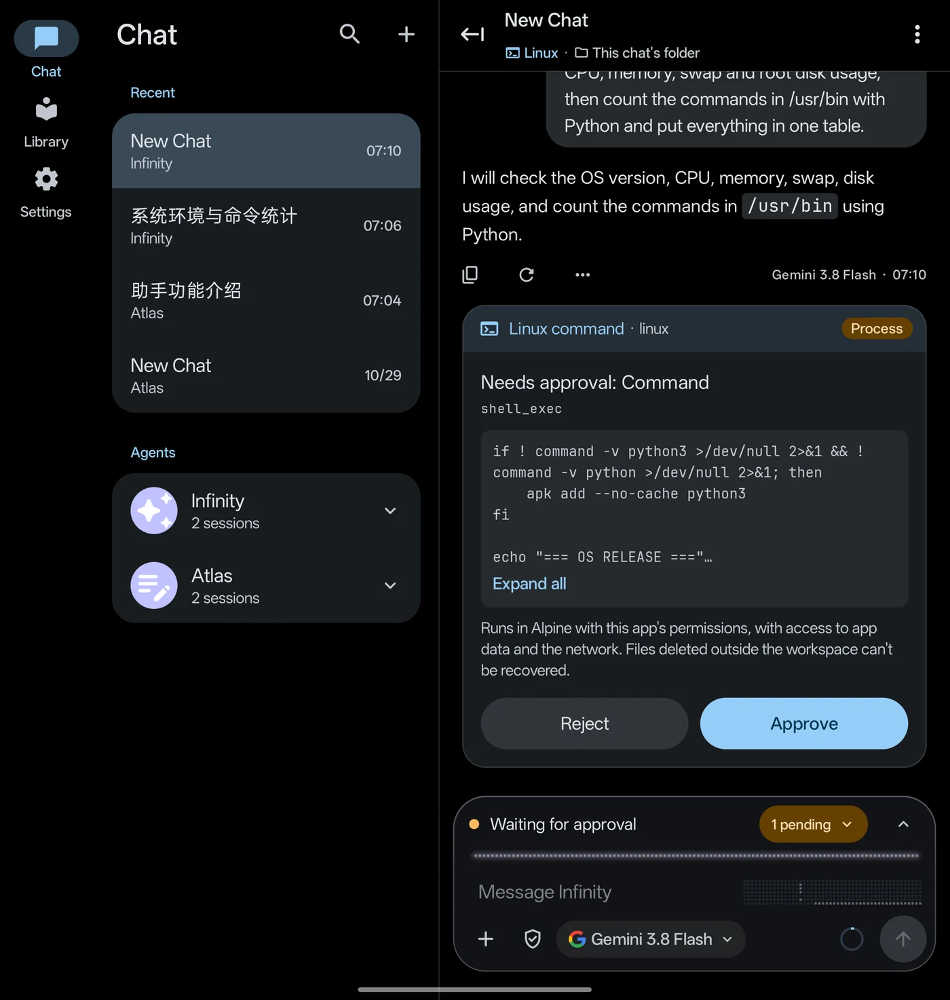
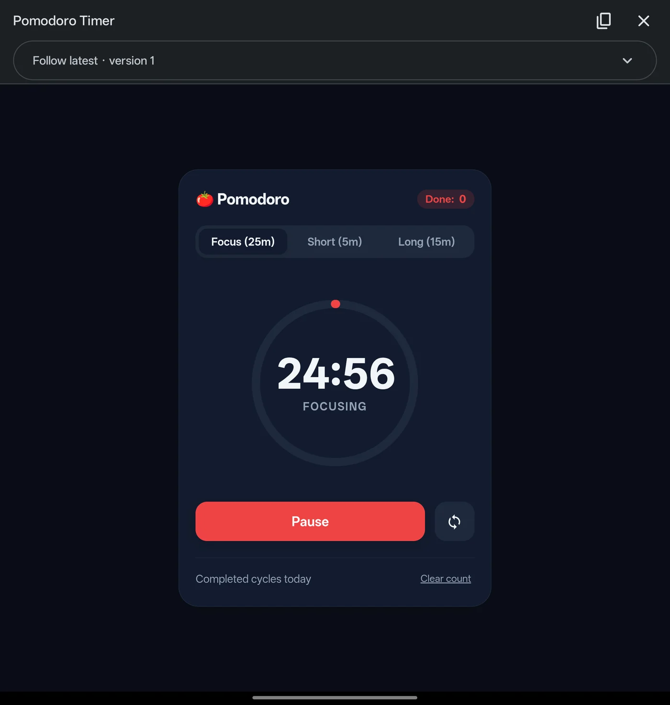
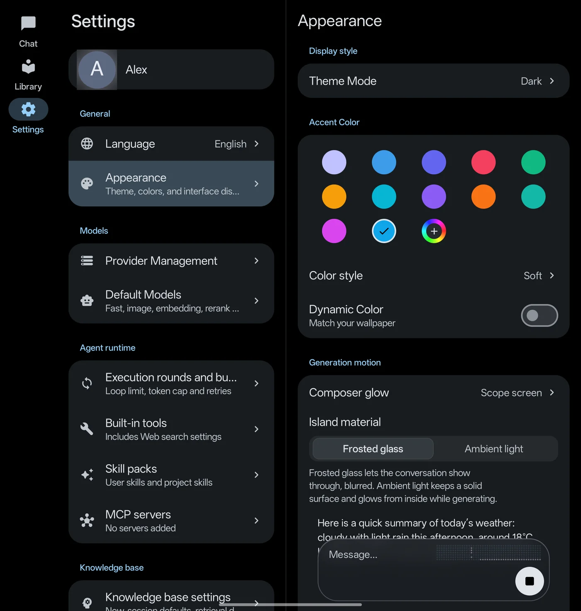

<p align="center">
  <picture>
    <source media="(prefers-color-scheme: dark)" srcset="assets/branding/infinity-dots-dark.svg">
    
  </picture>
</p>

<h1 align="center">Infinity Workbench</h1>

<p align="center">
  An open-source, bring-your-own-key AI workbench for Android.<br>
  Chat with the models you choose, let agents run real commands in a built-in Linux, and keep your data on your device.
</p>

<p align="center">
  <b>English</b> · <a href="README.zh-CN.md">简体中文</a>
</p>

<p align="center">
  
  
  
  
  
</p>

<p align="center">
  
</p>

## Highlights

- **Your models, your keys.** OpenAI (Chat Completions and Responses), Anthropic, Google Gemini, Vertex AI, DeepSeek, GLM, Kimi and any OpenAI-compatible endpoint. Streaming, image input and per-chat model switching.
- **Agents that get work done.** Web search, file editing, scripts, image generation, task planning and an in-app browser. Agents can hand work to background sub-agents or propose a branch chat, and up to four chats can generate at the same time.
- **A real Linux on your phone.** The sideload build installs Alpine Linux in one tap (proot, no root, no Termux) with git and Python available. SSH hosts, Termux and a built-in Tailscale node are there when you need more.
- **You decide what runs.** Each chat has its own approval policy. Commands appear as cards you approve or reject before anything executes.
- **Canvas.** Agents build interactive HTML pages with live preview and version history, saved as files in the chat's workspace.
- **Library with RAG and a knowledge graph.** Import TXT, Markdown, PDF, Word and HTML. Hybrid vector and full-text retrieval, reranking, citations and a persistent knowledge graph.
- **Workspaces and Git.** Per-chat folders, a built-in file system, mounted external folders and Git with credentials kept out of the model's reach.
- **Runs in the background.** Generation continues when you leave the app; long commands run as background tasks; agents can schedule one-off, interval or cron jobs, each with your approval.
- **Rich output and adaptive layout.** Markdown, LaTeX, Mermaid, ECharts and content-sized tables. Three panes on foldables and tablets.
- **Private by default.** Keys live in Android Keystore. Chats, documents and settings stay on the device, and model calls go straight to the provider you configured.

## Screenshots

<table>
  <tr>
    <td width="50%"></td>
    <td width="50%"></td>
  </tr>
  <tr>
    <td align="center">Agent results rendered as tables</td>
    <td align="center">Approve commands before they run</td>
  </tr>
  <tr>
    <td width="50%"></td>
    <td width="50%"></td>
  </tr>
  <tr>
    <td align="center">Canvas: interactive pages built by agents</td>
    <td align="center">Themes, accent colors and generation effects</td>
  </tr>
</table>

## Get started

**Requirements:** Android 12 (API 31) or later. The built-in Linux needs the sideload build on an arm64-v8a device, about 64 MB for the base system and about 200 MB with git and Python.

**Builds:** `sideload` includes the built-in Linux and device file access; `play` leaves both out. Both use the package name `com.promenar.infinity`, so they install alongside the old Nexara app.

**Install:** Download the APK and its `.sha256` file from [GitHub Releases](https://github.com/Promenar/Infinity-Workbench/releases), check the SHA-256 and install it. Public releases can lag behind the source tree. Do not install CI artifacts, debug APKs or repackaged builds from other sources.

The source tree is at `v0.6.1-beta` (versionCode `18`). See the [changelog](CHANGELOG.md) for what changed.

## Build from source

You need JDK 17 or newer, the Android SDK, `python3.14` on `PATH` (it precompiles the bundled Python) and Go 1.21 or newer (it builds the Tailscale library).

```bash
cd native-ui
./gradlew :app:assembleSideloadDebug :app:assemblePlayDebug
./gradlew :app:testSideloadDebugUnitTest :app:lintSideloadDebug
```

Debug APKs are written to `native-ui/app/build/outputs/apk/<flavor>/debug/`. Offline builds, signing and release checks are covered in [Development and release verification](docs/guide/development.md) and [Distribution builds](docs/distribution-builds.md).

## Documentation

The detailed guides are written in Chinese.

| Guide | Covers |
|---|---|
| [Features](docs/guide/features.md) | Chat and rendering, context management, RAG, agent tools, sub-agents, browser, background and scheduled tasks, export and backup |
| [Security and privacy](docs/guide/security-privacy.md) | Key storage, backup encryption, SSH, Git and Tailscale credentials, network security, diagnostics |
| [Execution environments](docs/guide/execution-environments.md) | Built-in Linux, Termux, sandboxed script runtimes, SSH |
| [Workspaces](docs/guide/workspaces.md) | Workspace types, Git, what agents can reach, mounted folders |
| [Install and upgrade](docs/guide/install-and-upgrade.md) | Requirements, data migration, APK verification |
| [Development](docs/guide/development.md) | Build commands, bundled Python and Tailscale, rich-content security, icons, tech stack |

See also the [architecture overview](docs/ARCHITECTURE.md) and the [guide index](docs/guide/README.md).

## License

Infinity Workbench is released under the [GNU General Public License v3.0](LICENSE). The settings list, navigation bar and appearance page include Compose adaptations of [Bettbox](https://github.com/appshubcc/Bettbox), also GPLv3. Sources and scope are listed in the [third-party notices](docs/legal/THIRD_PARTY_NOTICES.md).
