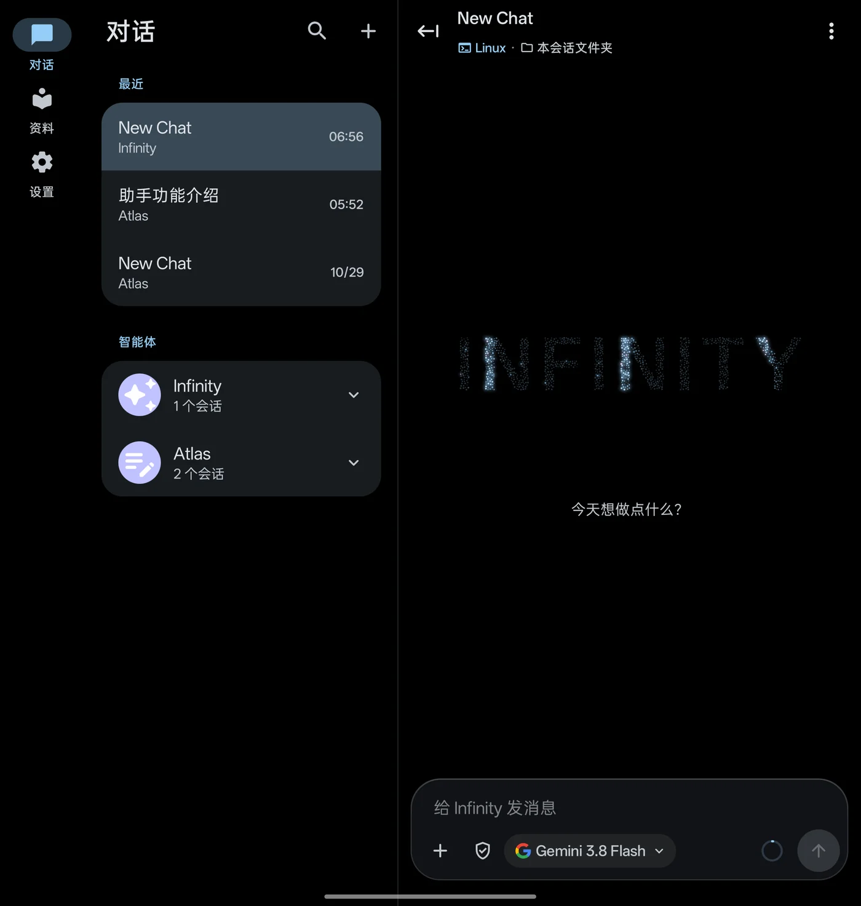
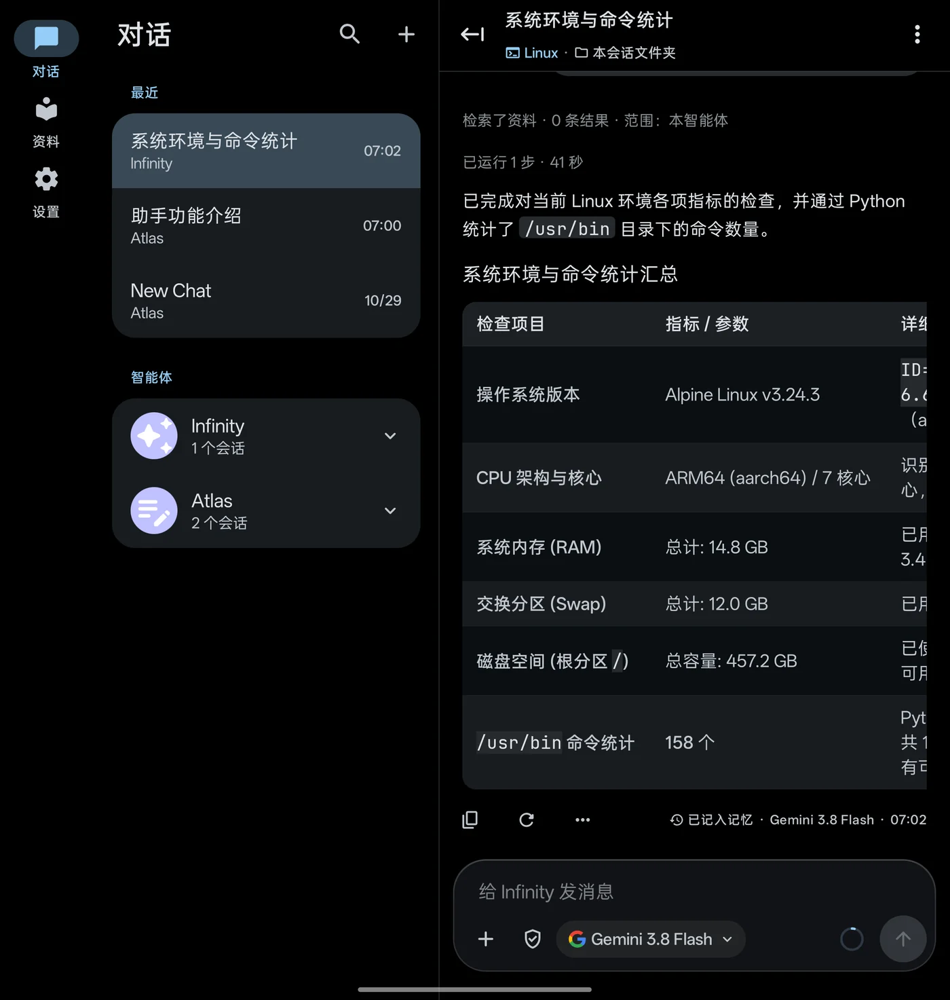
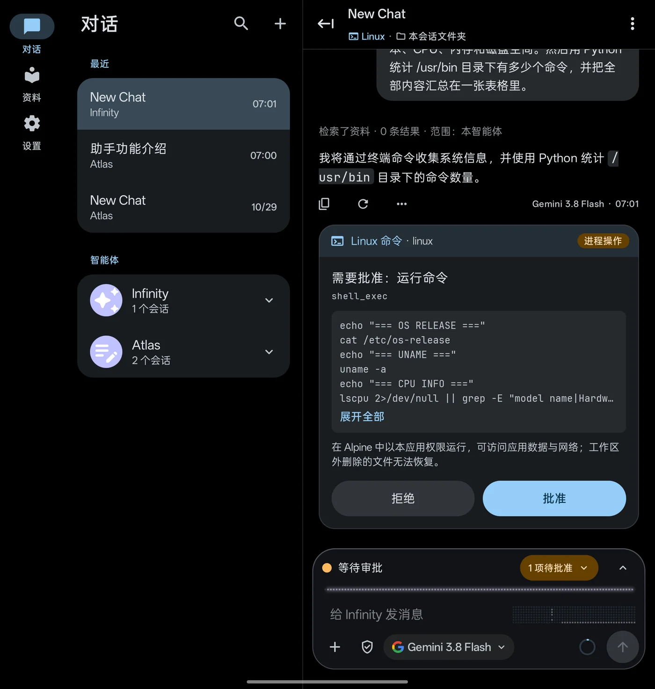
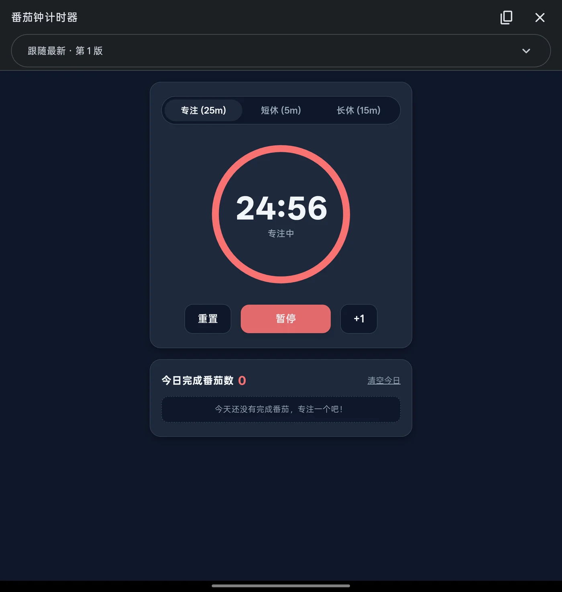
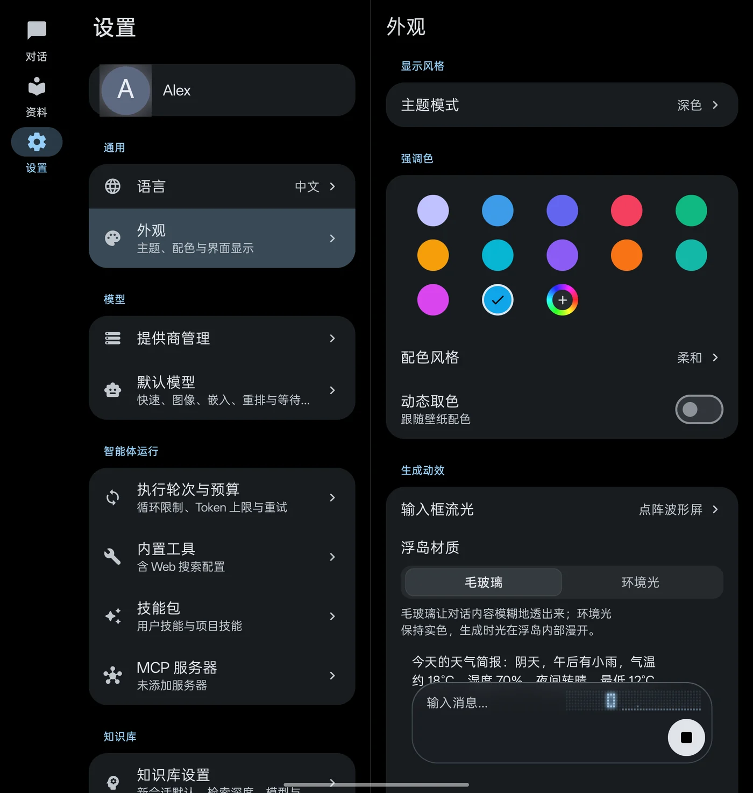

<p align="center">
  <picture>
    <source media="(prefers-color-scheme: dark)" srcset="assets/branding/infinity-dots-dark.svg">
    
  </picture>
</p>

<h1 align="center">Infinity Workbench</h1>

<p align="center">
  开源、自带密钥（BYOK）的 Android AI 工作台。<br>
  接入你选择的模型，让 Agent 在内置 Linux 中执行真实命令，数据留在自己的设备上。
</p>

<p align="center">
  <a href="README.md">English</a> · <b>简体中文</b>
</p>

<p align="center">
  
  
  
  
  
</p>

<p align="center">
  
</p>

## 亮点

- **自选模型，自带密钥**：支持 OpenAI（Chat Completions 与 Responses）、Anthropic、Google Gemini、Vertex AI、DeepSeek、GLM、Kimi 及任意 OpenAI 兼容接口，流式输出、图片输入，会话内可切换模型。
- **能干活的 Agent**：联网搜索、文件编辑、脚本、生图、任务规划和应用内浏览器；可把工作交给后台子代理或提议分支会话，最多 4 个会话同时生成。
- **手机里的真 Linux**：侧载版一键安装 Alpine Linux（proot，无需 root 或 Termux），可用 git 与 Python；另有 SSH、Termux 接入与内置 Tailscale 节点。
- **执行由你批准**：每个会话单独设置审批策略，命令先以卡片呈现，批准后才执行。
- **画布**：Agent 生成可交互的 HTML 页面，支持实时预览与版本记录，并作为文件保存在会话工作区。
- **资料库：RAG 与知识图谱**：导入 TXT、Markdown、PDF、Word、HTML，向量与全文混合检索、重排、引用追踪和持久知识图谱。
- **工作区与 Git**：会话专用空间、内置文件系统、外部文件夹挂载，Git 凭据不进入模型上下文。
- **后台持续运行**：切到后台仍继续生成；长命令作为后台任务运行；Agent 可创建单次、间隔或 cron 定时任务，每项都需你批准。
- **富内容与自适应布局**：Markdown、LaTeX、Mermaid、ECharts，表格按内容排版；折叠屏和平板为三栏布局。
- **默认保护隐私**：密钥由 Android Keystore 保护；会话、文档和配置保存在本机，模型请求直连你配置的服务商。

## 截图

<table>
  <tr>
    <td width="50%"></td>
    <td width="50%"></td>
  </tr>
  <tr>
    <td align="center">Agent 结果以表格呈现</td>
    <td align="center">命令执行前由你批准</td>
  </tr>
  <tr>
    <td width="50%"></td>
    <td width="50%"></td>
  </tr>
  <tr>
    <td align="center">画布：Agent 生成的交互页面</td>
    <td align="center">主题、强调色与生成动效</td>
  </tr>
</table>

## 开始使用

**运行要求**：Android 12（API 31）及以上。内置 Linux 需要侧载版和 arm64-v8a 设备，基础系统约占 64 MB，加装 git 与 Python 约 200 MB。

**两个渠道**：`sideload` 包含内置 Linux 与设备文件访问，`play` 不含这两项。两者包名均为 `com.promenar.infinity`，可与旧版 Nexara 并存。

**安装**：从 [GitHub Releases](https://github.com/Promenar/Infinity-Workbench/releases) 下载 APK 与对应 `.sha256` 文件，核对 SHA-256 后安装。公开发布可能落后于源码；不要安装 CI 临时制品、Debug APK 或来源不明的重打包版本。

当前源码版本为 `v0.5.1-beta`（versionCode `16`），变更见[更新日志](CHANGELOG.md)。

## 从源码构建

需要 JDK 17 及以上、Android SDK、`PATH` 中的 `python3.14`（预编译打包 Python）和 Go 1.21 及以上（编译 Tailscale 库）。

```bash
cd native-ui
./gradlew :app:assembleSideloadDebug :app:assemblePlayDebug
./gradlew :app:testSideloadDebugUnitTest :app:lintSideloadDebug
```

Debug APK 输出在 `native-ui/app/build/outputs/apk/<渠道>/debug/`。离线构建、签名与发行检查见[开发构建与发行验证](docs/guide/development.md)和[发行渠道构建](docs/distribution-builds.md)。

## 文档

| 文档 | 内容 |
|---|---|
| [功能详解](docs/guide/features.md) | 对话与渲染、上下文管理、RAG、Agent 工具、子代理、浏览器、后台与定时任务、导出与备份 |
| [密钥与隐私](docs/guide/security-privacy.md) | 密钥存储、备份加密、SSH/Git/Tailscale 凭据、网络安全、诊断事件 |
| [执行环境](docs/guide/execution-environments.md) | 内置 Linux、Termux、隔离脚本运行时、SSH |
| [工作区与外部文件夹](docs/guide/workspaces.md) | 工作区类型、Git、Agent 可达范围、文件夹挂载 |
| [安装、升级与数据迁移](docs/guide/install-and-upgrade.md) | 运行要求、数据迁移、APK 验真 |
| [开发构建与发行验证](docs/guide/development.md) | 构建命令、打包 Python 与 Tailscale、富内容安全策略、图标、技术栈 |

另见[架构说明](docs/ARCHITECTURE.md)与[使用指南索引](docs/guide/README.md)。

## 许可证

Infinity Workbench 以 [GNU General Public License v3.0](LICENSE) 发布。设置列表、底部导航与外观页包含对同为 GPLv3 的 [Bettbox](https://github.com/appshubcc/Bettbox) 视觉实现的 Compose 转译，来源与范围见[第三方通知](docs/legal/THIRD_PARTY_NOTICES.md)。
